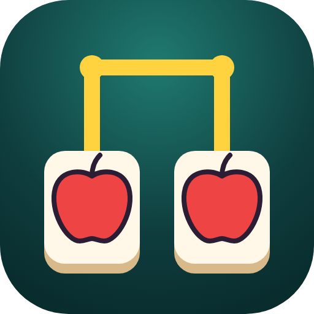
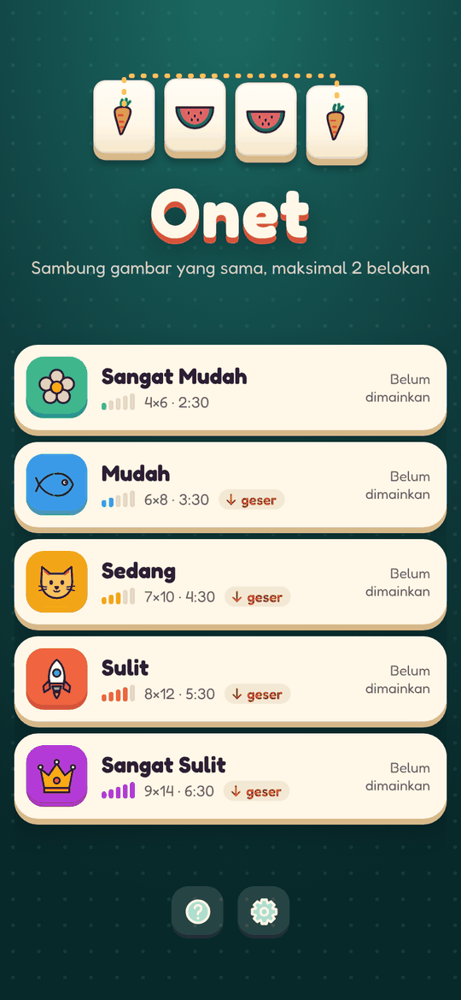
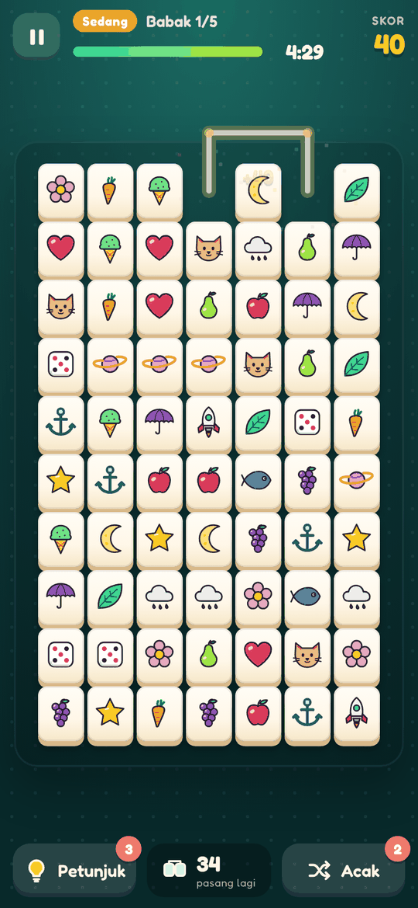
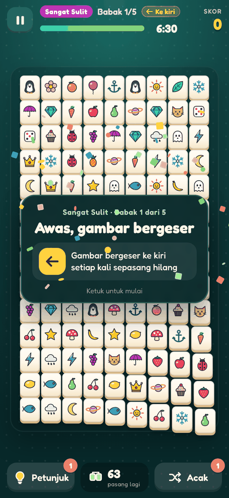
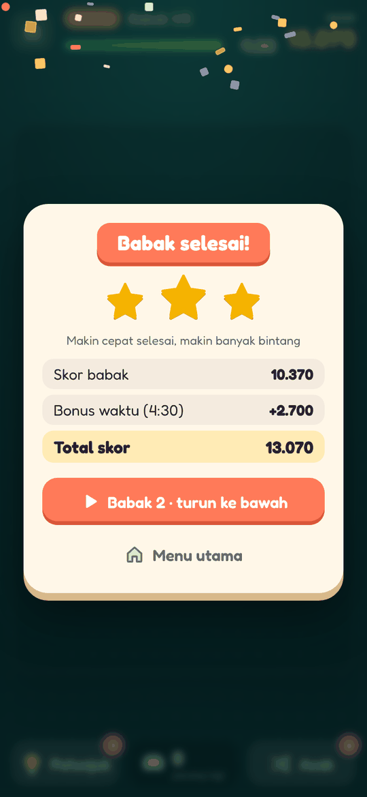
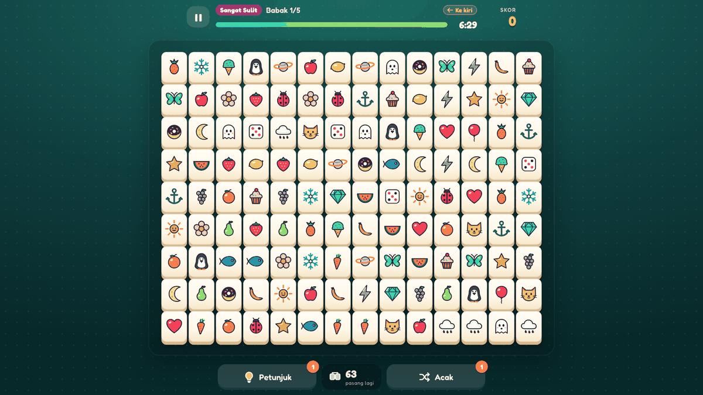

<div align="center">



# Onet: Sambung Gambar

**Game Onet klasik (tile connect) untuk browser dan HP.**
Cari dua gambar yang sama, sambungkan dengan garis maksimal 2 belokan, dan habiskan papan sebelum waktu habis.

[](https://lav-studio-org.github.io/onet/)

[](https://github.com/Lav-Studio-Org/onet/actions/workflows/test.yml)
[](https://github.com/Lav-Studio-Org/onet/actions/workflows/pages.yml)
[](https://github.com/Lav-Studio-Org/onet/releases)







</div>

## Cara main

1. Ketuk dua gambar yang **sama**.
2. Kalau keduanya bisa disambung garis dengan **paling banyak 2 belokan** tanpa menembus gambar lain, keduanya hilang. Garis boleh lewat **pinggir luar papan**.
3. Habiskan semua gambar sebelum waktu habis. Makin cepat selesai, makin banyak bintang.
4. Buntu? Pakai **Petunjuk** untuk melihat satu pasangan, atau **Acak** untuk mengocok ulang papan.

## Fitur

- **5 tingkat kesulitan × 5 babak**, dari papan 4 × 6 sampai 9 × 14.
- **Gambar bergeser** di babak lanjut: turun, naik, ke kiri, ke kanan, menjauh atau merapat ke tengah. Arah geser selalu tampil di HUD.
- **Papan dijamin tidak pernah macet.** Kalau tidak ada pasangan yang bisa disambung, papan diacak gratis (diuji pada 50.000 papan).
- **Skor combo**, bonus sisa waktu, bintang 1 sampai 3, dan rekor per tingkat.
- **Lanjutkan** dari babak terakhir yang belum tamat.
- **38 gambar SVG buatan sendiri**, musik dan efek suara yang disintesis langsung di browser.
- **Nyaman di HP dan desktop**: di layar lebar papan otomatis diputar mendatar.
- **PWA**: bisa dipasang di layar utama dan dimainkan offline.

<div align="center">

</div>

## Tingkat kesulitan

| Tingkat | Papan | Jenis gambar | Waktu babak 1 | Petunjuk / Acak | Pergeseran |
|---|---|---|---|---|---|
| Sangat Mudah | 4 × 6 (24) | 6 | 2:30 | 5 / 5 | tidak ada |
| Mudah | 6 × 8 (48) | 12 | 3:30 | 4 / 3 | babak 4–5 |
| Sedang | 7 × 10 (70) | 18 | 4:30 | 3 / 2 | babak 2–5 |
| Sulit | 8 × 12 (96) | 24 | 5:30 | 2 / 2 | semua babak |
| Sangat Sulit | 9 × 14 (126) | 32 | 6:30 | 1 / 1 | semua babak |

Tiap babak dibuka dengan banner aturan, dan timer baru berjalan setelah banner ditutup.

### Skor

- Tiap pasangan: (10 + 5 × jumlah belokan) × pengali tingkat × combo (pasangan beruntun dalam 3,5 detik).
- Selesai babak: bonus sisa waktu. Bintang 3 / 2 / 1 dari sisa waktu (≥ 50% / ≥ 25% / sisanya).

## Teknologi

HTML, CSS, dan JavaScript biasa. Tanpa build step, tanpa framework, tanpa library.

| Path | Isi |
|---|---|
| `index.html`, `style.css` | Tampilan, layar, dan sprite ikon UI |
| `js/board.js` | Logika papan murni: jalur 2 belokan, petunjuk, acak, pergeseran |
| `js/levels.js` | Tabel tingkat kesulitan |
| `js/tiles.js` | 38 gambar SVG |
| `js/game.js` | Alur game dan UI |
| `js/audio.js` | Efek suara dan musik (Web Audio) |
| `js/ads.js` | Lapisan iklan `ON.Ads` (iklan contoh di web) |
| `sw.js`, `manifest.webmanifest` | PWA dan mode offline |
| `scripts/` | Tes logika papan dan smoke test browser |
| `docs/` | Audit UI/UX, catatan rilis, screenshot |

### Iklan (siap untuk versi APK)

Semua iklan lewat `ON.Ads`. Placement berhadiah: `hint_refill`, `shuffle_refill`, `time_revive`; interstitial `stage_end` (dibatasi). Versi web memakai iklan contoh untuk hadiah dan tidak menampilkan interstitial. Untuk APK cukup sediakan `ON.nativeAdProvider` (AdMob via Capacitor).

## Jalankan lokal

```sh
git clone https://github.com/Lav-Studio-Org/onet.git
cd onet
python3 -m http.server 8123   # lalu buka http://localhost:8123/
```

### Tes

```sh
node scripts/test-board.js          # logika jalur dibandingkan dengan BFS brute force
node scripts/test-solvable.js 200   # ribuan permainan acak, papan tidak boleh macet
node scripts/smoke.js http://localhost:8123/ /tmp/shots   # Playwright: main beberapa babak + screenshot
```

Kedua tes logika juga jalan otomatis di GitHub Actions setiap push.

## Deploy dan rilis

- Setiap push ke `main` disalin ke branch `gh-pages` oleh `.github/workflows/pages.yml`, lalu disajikan GitHub Pages di https://lav-studio-org.github.io/onet/.
- Rilis baru: naikkan angka di `VERSION` dan tambahkan `docs/releases/v<versi>.md`. Workflow `release.yml` membuat GitHub Release-nya.

## Lisensi aset

Font [Fredoka](https://fonts.google.com/specimen/Fredoka) (SIL Open Font License). Semua gambar dan ikon dibuat khusus untuk game ini.
